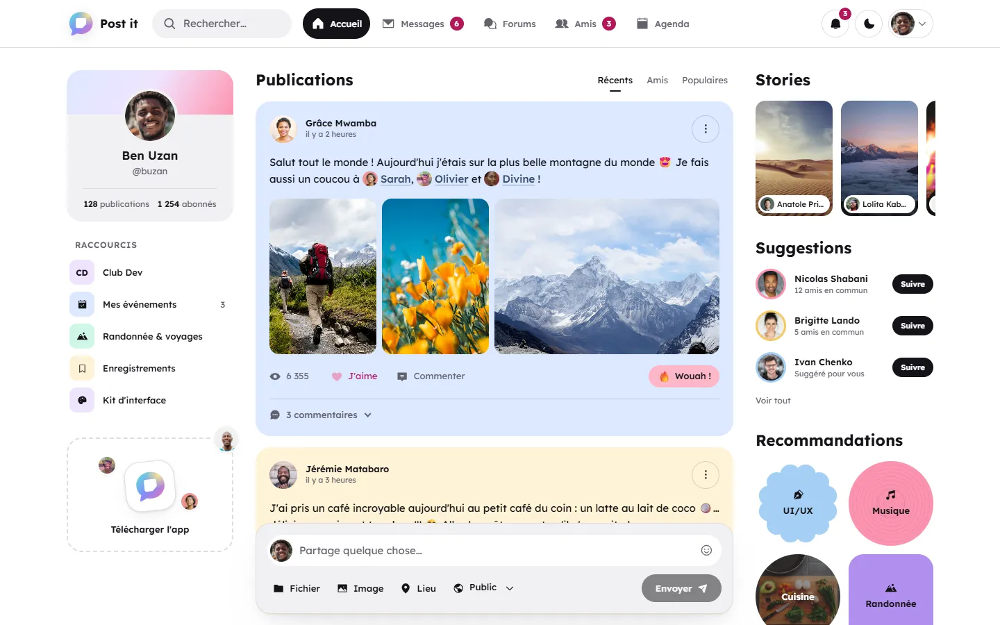

<div align="center">

# Post it

**Le réseau social étudiant de l'ESIS** — refonte 2026 d'un projet étudiant de 2022,
vitrine HTML/CSS moderne, sans framework ni étape de build.

[](https://github.com/Balick/esiss-social-web-site/actions/workflows/ci.yml)
[](LICENSE)


[**Voir la démo**](https://balick.github.io/esiss-social-web-site/) ·
[Contribuer](CONTRIBUTING.md) ·
[Signaler un bug](https://github.com/Balick/esiss-social-web-site/issues/new/choose)

</div>

<picture>
  <source media="(prefers-color-scheme: dark)" srcset="docs/screenshot-dark.webp">
  
</picture>

Né en 2022 comme projet étudiant « pour le fun » à l'ESIS (École Supérieure d'Informatique Salama,
Lubumbashi, RDC), **Post it** a été entièrement repensé en 2026 pour montrer tout ce que le HTML et
le CSS savent faire seuls aujourd'hui. Pas de React, pas de bundler, pas de dépendance à
l'exécution : un fichier `index.html`, des feuilles de style et quelques lignes de JavaScript
facultatives.

> [!NOTE]
> La [démo en ligne](https://balick.github.io/esiss-social-web-site/) est active dès que GitHub
> Pages est activé sur le dépôt (**Settings → Pages → Source : « GitHub Actions »**). Le workflow
> `pages.yml` la redéploie ensuite à chaque push sur `main`.

## Fonctionnalités

- **Fil filtrable** Récents / Amis / Populaires — sans JavaScript, grâce à `:has()`
- **Publications** avec galerie d'images, mentions d'amis et **réactions en popover**
- **Sondage en CSS pur** : on vote, les résultats s'affichent, sans aucun script
- **Compositeur de publication** qui s'agrandit avec le texte saisi
- **Stories** défilantes, avec accroche au défilement
- **Suggestions à suivre** et **recommandations** de centres d'intérêt
- **Thème clair / sombre** : suit le réglage du système, avec bascule manuelle
- **Responsive**, du mobile (360 px) au grand écran

## Ce que le projet démontre

- **Cascade layers** (`@layer`) — un ordre de priorité explicite, fini les guerres de spécificité.
- **Design tokens** en propriétés personnalisées — couleurs, espacements et rayons définis une fois.
- **OKLCH, `light-dark()`, `color-mix()`** — des couleurs cohérentes et un thème sombre sans doublon.
- **`:has()`** — le parent réagit à son contenu : filtres du fil et sondage sans JavaScript.
- **Container queries** — chaque composant s'adapte à la place dont il dispose, pas à la fenêtre.
- **API Popover + anchor positioning** — menus et réactions accessibles, placés par le CSS.
- **`@starting-style`** — des animations d'apparition, même depuis `display: none`.
- **`field-sizing: content`** — un champ de saisie qui grandit tout seul.
- **`<select>` personnalisable** (`appearance: base-select`) — stylé, mais toujours natif.
- **Nesting natif + nommage BEM** — un CSS lisible, sans préprocesseur.
- **Propriétés logiques** (`margin-inline`, `inset-block`…) — prêtes pour tous les sens d'écriture.
- **`clamp()`, `text-wrap: balance | pretty`** — une typographie fluide et des titres équilibrés.
- **`scroll-snap`** — un carrousel de stories natif, fluide au doigt comme à la souris.
- **HTML sémantique d'abord** — le JavaScript n'est qu'une amélioration progressive.

## Démarrer

Aucune installation n'est nécessaire pour voir le site. Au choix :

- ouvrez simplement `index.html` dans votre navigateur (double-clic : tout fonctionne en `file://`) ;
- ou servez le dossier : `npx serve .` ;
- ou utilisez l'extension **Live Server** de VS Code.

`npm install` ne sert qu'aux outils de qualité (Node.js 22.22 ou plus récent) :

```bash
git clone https://github.com/Balick/esiss-social-web-site.git
cd esiss-social-web-site
npm install
npm run lint     # stylelint + html-validate + prettier
npm run dev      # serveur local (équivaut à npx serve .)
```

## Structure du projet

```text
index.html              page unique (sprite d'icônes intégré)
assets/
  css/
    fonts.css           @font-face (Lexend variable, auto-hébergée)
    tokens.css          ordre des @layer + design tokens
    base.css            reset + styles de base
    layout.css          grille de l'application + responsive
    components/         un fichier par composant (@layer components)
      button.css avatar.css sidebar.css feed.css post.css popover.css
      composer.css stories.css suggestions.css topics.css toast.css
    utilities.css       .visually-hidden, etc.
  js/app.js             amélioration progressive (script classique, defer)
  fonts/                Lexend (woff2) + licence OFL
  icons/                SVG sources (Phosphor Icons), sprite.svg + licence
  images/               brand/, avatars/, posts/, stories/, topics/ (WebP)
docs/                   captures d'écran du README
.github/                CI (lint), déploiement GitHub Pages, modèles d'issues et de PR
CONTRIBUTING.md         conventions, recettes et checklist
CREDITS.md              auteurs et licences des photos, icônes et polices
package.json            outils de lint uniquement (aucune dépendance à l'exécution)
```

## Compatibilité navigateurs

Navigateurs « evergreen », **deux dernières versions** : Chrome, Edge, Firefox, Safari (macOS et
iOS), Samsung Internet.

Les fonctionnalités les plus récentes sont des **améliorations progressives** : sans _anchor
positioning_, menus et réactions retombent sur un positionnement classique (`@supports`) ; sans
`<select>` personnalisable, le menu de visibilité reste un `<select>` natif parfaitement
fonctionnel.

## Accessibilité

- Repères sémantiques (`header`, `nav`, `main`, `aside`) et titres hiérarchisés
- Entièrement utilisable au clavier, avec un focus toujours visible (`:focus-visible`)
- Animations réduites quand `prefers-reduced-motion` est activé
- Contrastes de texte visés au niveau WCAG AA, dans les deux thèmes
- Thème initial selon `prefers-color-scheme`, modifiable manuellement
- HTML validé automatiquement (html-validate, règles d'accessibilité incluses) à chaque push

## Contribuer

Les contributions sont les bienvenues, en particulier celles des étudiant·e·s de l'ESIS ! Lisez le
[guide de contribution](CONTRIBUTING.md) (conventions, recettes, checklist) et le
[code de conduite](CODE_OF_CONDUCT.md) avant d'ouvrir une pull request.

## Crédits

Photos [Unsplash](https://unsplash.com), icônes [Phosphor Icons](https://phosphoricons.com), police
[Lexend](https://www.lexend.com) : le détail des auteurs et des licences est dans
[CREDITS.md](CREDITS.md).

## Licence

Code sous licence [MIT](LICENSE) © 2022-2026 Théo Balick et les contributeurs de Post it. Les
photos, icônes et polices restent sous leur propre licence (voir [CREDITS.md](CREDITS.md)).

---

### English summary

**Post it** is a student social network mock-up for ESIS (Lubumbashi, DR Congo), first built in
2022 and fully redesigned in 2026 as a **modern HTML/CSS showcase**: no framework, no build step,
no runtime dependency. It features a feed filterable without JavaScript (`:has()`), popovers with
CSS anchor positioning, cascade layers, OKLCH colors with `light-dark()`, container queries and a
pure-CSS poll. Open `index.html` in any evergreen browser, or run `npx serve .`. Contributions are
welcome — see [CONTRIBUTING.md](CONTRIBUTING.md) (in French). Code licensed under MIT.
